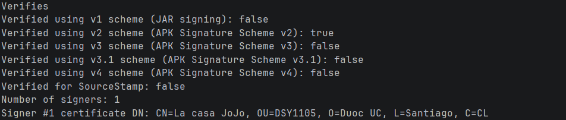
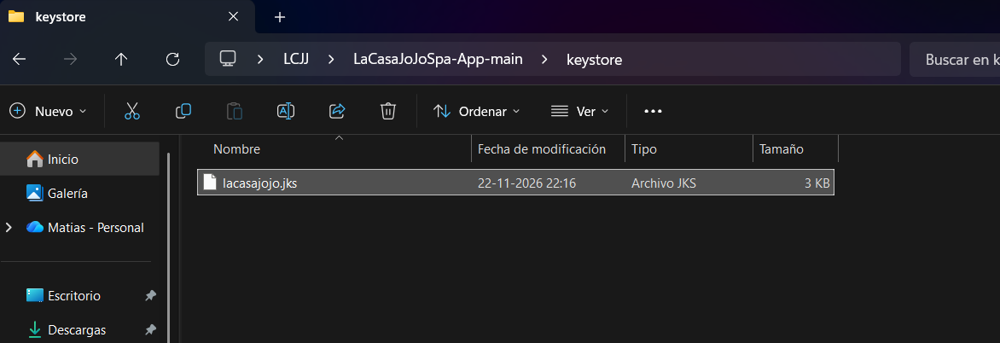

# La Casa JoJo — Evaluación Parcial 4

**Actualización de despliegue para la demostración:** 24 de noviembre de 2026 · Backend en AWS EC2.

**Asignatura:** DSY1105 · Desarrollo de Aplicaciones Móviles

**Institución:** Duoc UC

**Docente:** Nancy Bernal

**Tecnologías:** Kotlin, Jetpack Compose, MVVM, Retrofit, Spring Boot, H2, JUnit, MockK, AWS EC2, SSH y systemd.

Aplicación Android de gestión de menú y pedidos. Un administrador gestiona cuentas; el dueño administra platos y pedidos; y los clientes consultan el menú, personalizan platos, realizan pedidos y revisan su boleta. Los datos se comparten mediante tres microservicios propios, y la pantalla de cliente muestra información meteorológica obtenida desde Open-Meteo.

## Integrantes

- Matías Tiznado
- Gerard Foix
- Juan Pablo Asenjo


## Arquitectura

El backend está desplegado en una instancia Amazon EC2. La aplicación Android conserva su configuración original para el emulador: `10.0.2.2`. Un túnel SSH reenvía las solicitudes del computador anfitrión a los microservicios de EC2, sin publicar los puertos de las API en Internet.

```text
Android (Kotlin + Jetpack Compose)
  └─ ViewModel / StateFlow → AppRepository → Retrofit
       ├─ API propia (10.0.2.2:8081, 8082, 8083)
       │    └─ Windows (127.0.0.1) → túnel SSH (TCP 22)
       │         └─ AWS EC2 (Amazon Linux 2023)
       │              ├─ usuarios-service :8081 → H2 usuariosdb
       │              ├─ menu-service     :8082 → H2 menudb + data/fotos
       │              └─ pedidos-service  :8083 → H2 pedidosdb
       └─ Open-Meteo (API externa de clima, HTTPS)
```

Cada microservicio se ejecuta como un servicio independiente de `systemd`. Las bases H2 y las fotografías se conservan en el disco de EC2. Open-Meteo se consulta directamente desde Android y no atraviesa el túnel.

**Backend:** [`backend/`](backend/) · **Código Android:** [`app/`](app/) · **Pruebas:** `app/src/test/`.

DataStore conserva información local de apoyo (por ejemplo, una copia de menú); las operaciones compartidas de usuarios, platos y pedidos se resuelven en los microservicios. Al mantener una sesión abierta, la app consulta periódicamente los datos del servidor (aproximadamente cada 10 segundos), de modo que dos dispositivos conectados al mismo backend pueden observar los cambios.

## Funcionalidades por rol

| Rol | Funcionalidades |
|---|---|
| **Administrador** | Consulta de usuarios, creación de cuentas de dueño, activación y bloqueo de cuentas. |
| **Dueño** | Crear, consultar, editar y eliminar platos; administrar agregados, ensaladas y disponibilidad; tomar y subir fotografías; consultar pedidos y cambiar sus estados. |
| **Cliente** | Registro e inicio de sesión, consulta del menú y fotografías, armado de platos, carrito, confirmación de pedidos, boletas e historial. |

También incluye validaciones de formularios, navegación con Jetpack Compose, animaciones, cámara y vibración. El menú emplea tarjetas y fotografías con una línea visual blanca, crema y naranja. El clima se presenta en una tarjeta integrada al menú del cliente; **su funcionamiento fue comprobado por el equipo**.

### Fotografías compartidas

Las fotos tomadas por el dueño se suben como JPG a `menu-service` (`POST /api/fotos`). El backend entrega una ruta compartida para que otros dispositivos puedan mostrar la misma foto. Las imágenes guardadas anteriormente solo como rutas locales del dispositivo deben volver a subirse para que sean visibles en otro celular.

## Microservicios y endpoints

En el emulador, `HOST` corresponde a `10.0.2.2`; desde el Windows con el túnel abierto o desde EC2, a `127.0.0.1`. Las API no se consultan directamente mediante la IP pública de EC2.

### Usuarios — `http://HOST:8081`

| Método | Endpoint | Propósito |
|---|---|---|
| `POST` | `/api/usuarios/login` | Iniciar sesión. |
| `POST` | `/api/usuarios` | Registrar usuarios o crear cuentas autorizadas. |
| `GET` | `/api/usuarios` | Listar usuarios, con verificación de administrador. |
| `PUT` | `/api/usuarios/estado?email=&activo=` | Activar o bloquear cuentas. |

### Menú — `http://HOST:8082`

| Método | Endpoint | Propósito |
|---|---|---|
| `GET`, `POST` | `/api/platos` | Consultar y crear platos. |
| `GET`, `PUT`, `DELETE` | `/api/platos/{id}` | Consultar, editar y eliminar un plato. |
| `GET`, `POST` | `/api/extras` | Consultar y crear agregados/ensaladas. |
| `PUT`, `DELETE` | `/api/extras/{id}` | Actualizar o eliminar extras. |
| `POST` | `/api/fotos` | Subir fotografía JPG. |
| `GET` | `/api/fotos/{nombre}` | Recuperar fotografía del backend. |

### Pedidos — `http://HOST:8083`

| Método | Endpoint | Propósito |
|---|---|---|
| `GET`, `POST` | `/api/pedidos` | Consultar o registrar pedidos. |
| `GET` | `/api/pedidos/{numero}` | Consultar un pedido. |
| `PUT` | `/api/pedidos/{numero}/estado?estado=` | Cambiar estado del pedido. |

Estados disponibles: `RECIBIDO`, `EN_PREPARACION`, `LISTO`, `ENTREGADO`, `CANCELADO`.

### API externa — Open-Meteo

Consulta por Retrofit en `ClimaApi`, con la ruta base:

`GET https://api.open-meteo.com/v1/forecast?latitude=-33.45&longitude=-70.66&current_weather=true`

La información meteorológica se muestra en el menú del cliente con temperatura y sugerencias. Requiere conexión a Internet; **no reemplaza ni modifica las bases de datos de los microservicios**.

## Ejecución principal — AWS EC2

### Infraestructura desplegada

| Componente | Configuración |
|---|---|
| Plataforma | AWS Academy Learner Lab / Amazon EC2 |
| Instancia | `LaCasaJoJo-Backend`, `t3.medium` (2 vCPU, 4 GiB RAM) |
| Región | `us-east-1` (Norte de Virginia) |
| Sistema operativo | Amazon Linux 2023, x86_64 |
| Almacenamiento | EBS gp3, 20 GiB |
| Dirección de conexión | Elastic IP asociada a la instancia |
| Entorno Java | Amazon Corretto 17; Maven 3.8.4; Git 2.50.1 al desplegar |
| Seguridad de red | SSH TCP 22; API internas en `127.0.0.1:8081–8083` |
| Administración | `systemd`, inicio automático y reinicio ante fallos |
| Persistencia | H2 en archivos y JPG en el disco de la instancia |

La Elastic IP vigente y la llave privada se gestionan por separado del repositorio público. La llave `labsuser.pem` **no debe subirse a GitHub** ni compartirse con personas no autorizadas. Se recomienda limitar SSH a las IP de las redes autorizadas.

### 1. Requisitos del computador de demostración

- Windows con cliente OpenSSH (`ssh -V` para comprobarlo).
- Android Studio, Android SDK y un emulador compatible, o un emulador Android ya configurado para instalar el APK.
- Conexión a Internet y acceso SSH saliente por TCP 22 permitido por la red.
- Acceso autorizado a la instancia y a su llave privada.
- Puertos locales 8081, 8082 y 8083 disponibles.
- Archivo `Conectar-LaCasaJoJo.bat` preparado por el equipo, o ejecutar manualmente el comando SSH indicado abajo.

**No se requiere instalar Maven ni ejecutar el backend en Windows para esta modalidad.** La compilación de Android desde código fuente sí requiere su propio entorno Gradle/JDK/SDK; instalar el APK existente no requiere compilar el proyecto.

### 2. Encender EC2 y comprobar su estado

1. Iniciar AWS Academy Learner Lab y abrir la consola de EC2 en `us-east-1`.
2. Verificar que `LaCasaJoJo-Backend` esté en estado `Running`; iniciarla si está detenida.
3. Confirmar la Elastic IP vigente y esperar a que los servicios terminen de arrancar.
4. Verificar que el grupo de seguridad `LaCasaJoJo-SG` permita SSH desde la red de demostración.

Los microservicios se inician automáticamente con `systemd`. El inicio del laboratorio, la disponibilidad de la instancia y la conectividad de la red siguen siendo requisitos. Si el laboratorio elimina los recursos en vez de detenerlos, será necesario volver a desplegar y restaurar los datos desde un respaldo.

### 3. Conectar el túnel SSH desde Windows

El BAT preparado para la demostración utiliza la llave `labsuser.pem` en Descargas. También se puede establecer el túnel desde PowerShell, reemplazando `IP_ELASTICA_EC2` por la dirección vigente de la instancia:

```powershell
ssh -i "$HOME\Downloads\labsuser.pem" -N -o ExitOnForwardFailure=yes -o ServerAliveInterval=30 -L 127.0.0.1:8081:127.0.0.1:8081 -L 127.0.0.1:8082:127.0.0.1:8082 -L 127.0.0.1:8083:127.0.0.1:8083 ec2-user@IP_ELASTICA_EC2
```

En la primera conexión, comprobar la huella del servidor mediante la consola de AWS antes de aceptarla. Mantener abierta la ventana del BAT o de SSH mientras se utiliza la aplicación. El túnel no inicia los microservicios: solo transporta sus solicitudes a EC2. Después de reiniciar EC2 o cambiar de computador se debe establecer de nuevo.

Si se necesita recrear el BAT, guardar el siguiente contenido como `Conectar-LaCasaJoJo.bat` (tipo «Todos los archivos») y sustituir el marcador de IP:

```bat
@echo off
title LaCasaJoJo - Conexion AWS EC2
echo Conectando con LaCasaJoJo en AWS...
echo Mantener esta ventana abierta mientras se utiliza la aplicacion.
ssh -i "%USERPROFILE%\Downloads\labsuser.pem" -N -o ExitOnForwardFailure=yes -o ServerAliveInterval=30 -L 127.0.0.1:8081:127.0.0.1:8081 -L 127.0.0.1:8082:127.0.0.1:8082 -L 127.0.0.1:8083:127.0.0.1:8083 ec2-user@IP_ELASTICA_EC2
echo Conexion SSH finalizada.
pause
```

Comprobar desde otra PowerShell local que la API devuelve los platos de EC2:

```powershell
curl.exe http://127.0.0.1:8082/api/platos
```

Para verificar los tres servicios, desde la raíz del repositorio:

```powershell
powershell -ExecutionPolicy Bypass -File .\scripts\verificar-demo.ps1
```

La respuesta `403` al consultar la lista de usuarios sin autorización es esperada. Si hay conflicto de puertos, comprobar que no se estén ejecutando microservicios locales u otro túnel:

```powershell
Get-NetTCPConnection -LocalPort 8081,8082,8083 -State Listen -ErrorAction SilentlyContinue
```

### 4. Ejecutar Android

**Opción A — desde el código fuente:** abrir el proyecto en Android Studio, completar la sincronización de Gradle, iniciar un emulador y pulsar Run en el módulo `app`.

**Opción B — APK firmado (alternativa sin compilación):** iniciar el emulador, arrastrar [`apk/app-release.apk`](apk/app-release.apk) a su pantalla y abrir LaCasaJoJo. Si existe una versión de desarrollo con firma distinta, desinstalarla primero; se perderán sus datos locales, no los del servidor.

Ambas opciones conservan el host `10.0.2.2`. El túnel abierto en Windows comunica el emulador con los tres servicios remotos. Para el APK actual no es necesario cambiar `ApiConfig.kt`, recompilar Android ni incluir la IP pública de AWS dentro de la aplicación.

**Alcance de esta modalidad:** se ha probado con el emulador de Android Studio. Un teléfono físico no puede utilizar `10.0.2.2` para llegar al computador; requeriría una configuración de red y acceso diferente, no cubierta por este despliegue.

### 5. Validaciones realizadas el 24 de noviembre de 2026

- Compilación Maven de los tres módulos en EC2 con `BUILD SUCCESS` (se omitieron las pruebas en esa compilación de despliegue).
- Inicio de los tres microservicios y conexión con sus bases H2.
- Consulta `GET /api/platos` desde EC2 y desde Windows mediante el túnel: respuesta JSON con seis platos iniciales.
- Funcionamiento de la aplicación desde Android Studio con inicio de sesión, menú, pedidos, gestión de platos y fotografías, según las pruebas manuales realizadas.
- Reinicio de EC2 y comprobación de los tres servicios en estado `active`, sin iniciarlos manualmente; persistencia de datos y funcionamiento de Android tras reconectar SSH.
- Conexión mediante el BAT con las otras terminales de administración cerradas.
- Instalación y prueba del APK release existente en el emulador con el backend de EC2, sin recompilar Android.

Estas son comprobaciones de la demostración académica; no constituyen pruebas de carga ni una certificación de seguridad de producción.

## Administración y despliegue del backend en EC2

Esta sección documenta cómo se preparó el servidor. No es necesario repetirla en cada presentación si la instancia y sus archivos se conservan.

### Instalación y compilación inicial

Conectarse mediante SSH como `ec2-user` y ejecutar en Amazon Linux 2023:

```bash
sudo dnf install -y java-17-amazon-corretto-devel maven git
cd ~
git clone https://github.com/Gerard419/LaCasaJoJoSpa-App.git
cd LaCasaJoJoSpa-App/backend
mvn clean package -DskipTests
```

Se generan tres JAR ejecutables, en `usuarios-service/target/`, `menu-service/target/` y `pedidos-service/target/`, respectivamente (`*-service-1.0.0.jar`).

### Inicio automático mediante systemd

La plantilla instalada en `/etc/systemd/system/lacasajojo@.service` contiene:

```ini
[Unit]
Description=LaCasaJoJo - %i-service
After=network.target

[Service]
Type=simple
User=ec2-user
WorkingDirectory=/home/ec2-user/LaCasaJoJoSpa-App/backend/%i-service
ExecStart=/usr/bin/java -Xmx512m -jar target/%i-service-1.0.0.jar --server.address=127.0.0.1
Restart=on-failure
RestartSec=5

[Install]
WantedBy=multi-user.target
```

Después de guardar la plantilla, detener primero cualquier instancia manual anterior de los mismos microservicios (para no duplicar procesos ni bloquear H2). Habilitar e iniciar los servicios:

```bash
sudo systemctl daemon-reload
sudo systemctl enable --now lacasajojo@{usuarios,menu,pedidos}.service
```

Cada `WorkingDirectory` mantiene las rutas relativas de su base H2 y sus fotografías. El límite de heap Java es 512 MiB por servicio; los puertos quedan restringidos al loopback del servidor.

### Comprobación y mantenimiento

```bash
sudo systemctl is-enabled lacasajojo@{usuarios,menu,pedidos}.service
sudo systemctl is-active lacasajojo@{usuarios,menu,pedidos}.service
sudo systemctl status lacasajojo@{usuarios,menu,pedidos}.service --no-pager
ss -ltnp | grep -E '8081|8082|8083'
curl http://127.0.0.1:8082/api/platos
```

Los estados esperados son `enabled` y `active` para cada servicio. Revisar además los puertos y las respuestas HTTP, porque un proceso activo puede estar todavía inicializando Spring Boot.

Para revisar el registro del servicio de menú:

```bash
sudo journalctl -u lacasajojo@menu.service -n 50 --no-pager
```

Si se autoriza actualizar el backend, respaldar los datos, detener los servicios antes de reemplazar sus JAR, actualizar el código, compilar y volver a iniciarlos. No ejecutar procesos `nohup` adicionales mientras `systemd` administra los microservicios.

Los archivos persistentes se encuentran en `backend/usuarios-service/data/`, `backend/menu-service/data/` (incluye `fotos/`) y `backend/pedidos-service/data/`. Reiniciar o detener la instancia conserva estos datos mientras se mantenga el volumen EBS. La IP elástica no constituye un respaldo ni garantiza que el laboratorio conserve los recursos indefinidamente.

## Alternativa — backend local en Windows

El modo local original sigue disponible para desarrollo independiente de AWS. Requiere Java 17, Maven y los puertos 8081–8083 libres. Cerrar antes el túnel SSH si está activo.

Desde la raíz del repositorio:

```powershell
.\backend\run-all.bat
```

Mantener los tres procesos encendidos y ejecutar Android con su configuración habitual `10.0.2.2`. Comprobar las API con `scripts/verificar-demo.ps1` como se explicó arriba. Este modo utiliza las bases H2 locales, independientes de las de EC2: no sincroniza automáticamente los datos entre ambos entornos.

Para el desarrollo local con un teléfono físico en una red de prueba autorizada, el proyecto permite compilar indicando el host local mediante `jojoBackendHost`:

```powershell
.\gradlew.bat assembleDebug "-PjojoBackendHost=192.168.1.50"
```

Sustituir la IP de ejemplo por la del computador que ejecuta el backend local. Esta opción no convierte el APK existente en un APK para teléfonos físicos ni implica publicar las API en Internet.

## Cuentas de demostración

El microservicio de usuarios contempla cuentas de prueba iniciales:

| Rol | Correo | Contraseña de demostración |
|---|---|---|
| Administrador | `admin@lacasajojo.cl` | `Admin123` |
| Dueño | `dueno@lacasajojo.cl` | `Dueno123` |
| Cliente | Registro desde la app | La definida en el registro |

Estas cuentas son **únicamente para un entorno académico de prueba, local o EC2 mediante el túnel autorizado**. No publicar este backend directamente en Internet ni utilizar datos personales reales; el sistema no implementa autenticación de producción.

## Pruebas unitarias y cobertura

Las pruebas se implementaron con **JUnit, MockK y coroutines-test** y evalúan `AppRepository`, ViewModels, reglas de negocio, validaciones y tratamiento del clima.

En los resultados de la última versión auditada del proyecto se registraron **111 pruebas ejecutadas, 111 aprobadas, 0 fallidas y 0 omitidas**. Las pruebas pueden repetirse con:

```powershell
.\gradlew.bat testDebugUnitTest
```

Informe HTML: `app/build/reports/tests/testDebugUnitTest/index.html`.

Para generar el reporte de JaCoCo y calcular el alcance lógico documentado:

```powershell
.\gradlew.bat createDebugUnitTestCoverageReport
python .\scripts\coverage_logic.py
```

**Resultado del último informe incluido en el proyecto:** `93,1 %` de **instrucciones cubiertas dentro del alcance definido por el script**, formado por `repository`, `viewmodel`, `model` y las utilidades puras `Validaciones`, `Formato` y `ClimaTexto`. Son 5.862 instrucciones cubiertas de 6.296 analizadas. El resultado procede de `app/build/reports/coverage/test/debug/report.xml` y se calcula sin modificar el informe original.

**Nota sobre el alcance:** el porcentaje anterior **no es la cobertura global de toda la aplicación**. JaCoCo también contabiliza componentes visuales Compose, adaptadores Android, configuración de Retrofit y otras clases en su porcentaje global. Se mantiene disponible el reporte completo para que la docente evalúe si el alcance lógico documentado responde a la rúbrica. Que 111 pruebas aprueben no significa que todas las funcionalidades de interfaz estén automatizadas.

## APK release y firma digital

**Estado comprobado por el equipo:**

- Se generó `app-release.apk` mediante `assembleRelease`.
- Se verificó su firma con `apksigner`, incluyendo esquema **v2 válido** y un firmante.
- Se instaló **ese APK release** en un emulador nuevo denominado «LaCasaJoJo Release».
- La aplicación abrió y accedió a una cuenta de prueba y datos ya existentes en el backend.
- El 24 de noviembre de 2026 se volvió a instalar el APK release del repositorio y se comprobó su funcionamiento con EC2 mediante el túnel SSH, sin generar un APK nuevo.

**Archivos para la entrega:**

- APK firmado: [`apk/app-release.apk`](apk/app-release.apk)
- Llave de firma: `keystore/lacasajojo.jks`
- Configuración Gradle: [`app/build.gradle.kts`](app/build.gradle.kts)
- Ejemplo sin contraseñas: [`keystore.properties.example`](keystore.properties.example)

La configuración local `keystore.properties` contiene contraseñas y **NO debe subirse a GitHub público**. Antes de publicar el `.jks`, tener en cuenta que una llave privada compartida públicamente puede ser reutilizada por terceros; coordinar con la docente la entrega segura si se requiere entregar el archivo real.

### Evidencias de firma que exige el README

**Verificación de firma:**



**Archivo de llave de firma `.jks`:**



### Evidencia complementaria de instalación

La siguiente captura fue tomada tras instalar el APK release y comprobar su funcionamiento:


> Antes de subir el repositorio, verificar que las imágenes anteriores existan con **esos mismos nombres exactos** dentro de `docs/`. Si alguna tiene otro nombre, ajustar el enlace correspondiente.

## Uso de GitHub y Trello

La evaluación solicita actividad técnica real, commits por integrante y planificación con tareas distribuidas. La planificación y las tareas del equipo pueden consultarse en el tablero de Trello enlazado a continuación; el historial de cambios se puede verificar en GitHub.

- **Repositorio público del equipo:** [Gerard419/LaCasaJoJoSpa-App](https://github.com/Gerard419/LaCasaJoJoSpa-App).
- **Tablero Trello del equipo:** [La Casa JoJo — Evaluación Parcial 4](https://trello.com/b/KftOJt0C/la-casa-jojo-evaluacion-parcial-4).
- **Historial de colaboración:** debe ser verificable directamente en GitHub, tanto para Android como para los microservicios. No atribuir tareas o commits a quien no los haya realizado.

**Evidencia visual del tablero Trello:**


> La evidencia visual del tablero se encuentra en `docs/trello_image.jpeg`. Los cambios y asignaciones reales se comprueban en el tablero enlazado.

## Guion breve de demostración

1. Iniciar AWS Academy y EC2, comprobar el inicio automático de los tres microservicios, abrir el túnel SSH con el BAT y ejecutar la aplicación en el emulador.
2. Entrar como dueño, mostrar el menú y crear/editar un plato con precio y fotografía.
3. Entrar como cliente en el mismo emulador tras cerrar sesión, o en otro emulador conectado al **mismo backend de EC2**, y comprobar el plato actualizado y su foto.
4. Armar un plato, confirmar pedido y abrir boleta.
5. Desde el dueño, cambiar el estado del pedido; desde cliente, comprobar el cambio.
6. Mostrar la tarjeta meteorológica de Open-Meteo.
7. Si la docente lo solicita, mostrar los resultados de pruebas y el procedimiento de firma.
8. Como evidencia del despliegue, mostrar el estado de los servicios en EC2 y consultar `/api/platos` para comprobar que los cambios de Android están almacenados en el servidor.

## Entrega y respaldo

- Se debe entregar el código fuente Android y backend, junto con README, APK y archivos de firma solicitados, según las instrucciones oficiales.
- La pauta contempla **repositorio GitHub público**, **entrega grupal en AVA** por un integrante y **activación individual en AVA** por cada estudiante.
- La pauta original restringe las modificaciones posteriores a la fecha límite. La actualización de documentación y despliegue para la nueva demostración debe mantenerse dentro de lo autorizado por la docente.
- Para trasladar la demostración a otro computador no es necesario copiar las bases H2: basta con conectarse a la misma instancia EC2 mediante el túnel autorizado. Para recuperar el entorno si se pierde la instancia, respaldar las bases H2 y fotos **con los tres servicios apagados** y guardarlas de forma privada. No utilizar información personal real.
- No subir llaves SSH `.pem`, credenciales de AWS, `keystore.properties`, `local.properties`, cachés `.gradle`, carpetas `build`, ni datos de prueba H2 con información privada.

---

**Alcance académico:** versión de Evaluación Parcial 4 con actualización de despliegue en AWS EC2 para su demostración; no es un servicio de producción ni una app publicada en Google Play.
