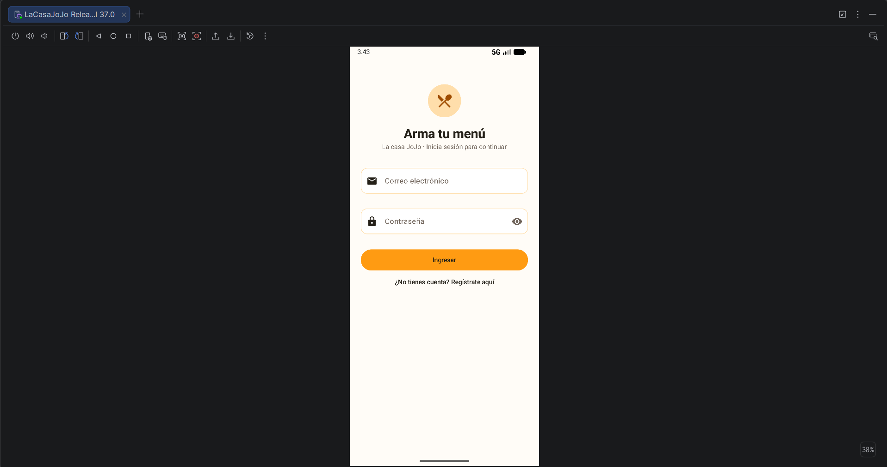
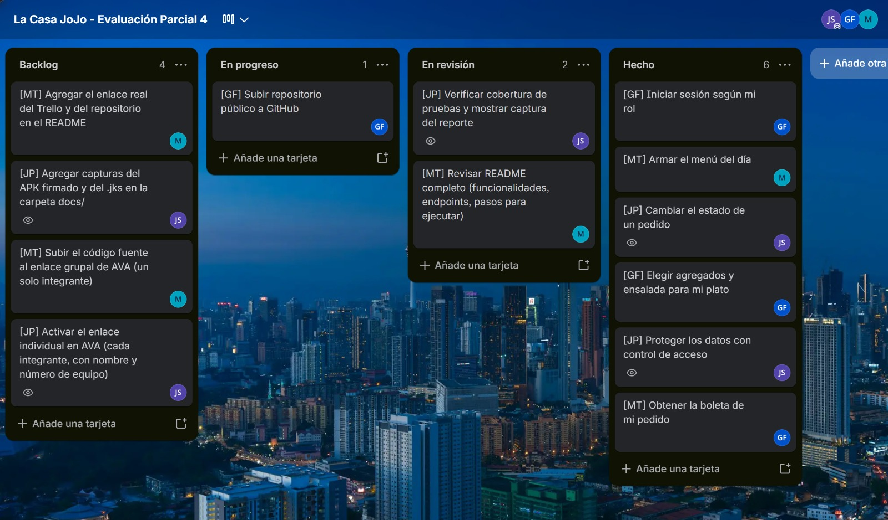

# La Casa JoJo — Evaluación Parcial 4

**Asignatura:** DSY1105 · Desarrollo de Aplicaciones Móviles

**Institución:** Duoc UC

**Docente:** Nancy Bernal

**Tecnologías:** Kotlin, Jetpack Compose, MVVM, Retrofit, Spring Boot, H2, JUnit y MockK.

Aplicación Android de gestión de menú y pedidos. Un administrador gestiona cuentas; el dueño administra platos y pedidos; y los clientes consultan el menú, personalizan platos, realizan pedidos y revisan su boleta. Los datos se comparten mediante tres microservicios propios, y la pantalla de cliente muestra información meteorológica obtenida desde Open-Meteo.

## Integrantes

- Matías Tiznado
- Gerard Foix

**Colaboración previa:** Juan Pablo Asenjo formó parte del equipo en etapas anteriores. Las tareas pendientes de la EP4 se redistribuyeron entre Matías y Gerard.

## Arquitectura

```text
Android (Kotlin + Jetpack Compose)
  └─ ViewModel / StateFlow → AppRepository → Retrofit
       ├─ usuarios-service (puerto 8081) → H2 usuariosdb
       ├─ menu-service    (puerto 8082) → H2 menudb + JPG en data/fotos
       ├─ pedidos-service (puerto 8083) → H2 pedidosdb
       └─ Open-Meteo (API externa de clima)
```

**Backend:** [`backend/`](backend/) · **Código Android:** [`app/`](app/) · **Pruebas:** `app/src/test/`.

DataStore conserva información local de apoyo (por ejemplo, una copia de menú); las operaciones compartidas de usuarios, platos y pedidos se resuelven en los microservicios. Al mantener una sesión abierta, la app consulta periódicamente los datos del servidor (aproximadamente cada 10 segundos), de modo que dos dispositivos conectados al mismo backend pueden observar los cambios.

## Funcionalidades por rol

| Rol | Funcionalidades |
|---|---|
| **Administrador** | Consulta de usuarios, creación de cuentas de dueño, activación y bloqueo de cuentas. |
| **Dueño** | Crear, consultar, editar y eliminar platos; administrar agregados, ensaladas y disponibilidad; tomar y subir fotografías; consultar pedidos y cambiar sus estados. |
| **Cliente** | Registro e inicio de sesión, consulta del menú y fotografías, armado de platos, carrito, confirmación de pedidos, boletas e historial. |

También incluye validaciones de formularios, navegación con Jetpack Compose, animaciones, cámara y vibración. El menú emplea tarjetas y fotografías con una línea visual blanca, crema y naranja. El clima se presenta en una tarjeta integrada al menú del cliente; **su funcionamiento fue comprobado por el equipo**.

### Fotografías compartidas

Las fotos tomadas por el dueño se suben como JPG a `menu-service` (`POST /api/fotos`). El backend entrega una ruta compartida para que otros dispositivos puedan mostrar la misma foto. Las imágenes guardadas anteriormente solo como rutas locales del dispositivo deben volver a subirse para que sean visibles en otro celular.

## Microservicios y endpoints

### Usuarios — `http://HOST:8081`

| Método | Endpoint | Propósito |
|---|---|---|
| `POST` | `/api/usuarios/login` | Iniciar sesión. |
| `POST` | `/api/usuarios` | Registrar usuarios o crear cuentas autorizadas. |
| `GET` | `/api/usuarios` | Listar usuarios, con verificación de administrador. |
| `PUT` | `/api/usuarios/estado?email=&activo=` | Activar o bloquear cuentas. |

### Menú — `http://HOST:8082`

| Método | Endpoint | Propósito |
|---|---|---|
| `GET`, `POST` | `/api/platos` | Consultar y crear platos. |
| `GET`, `PUT`, `DELETE` | `/api/platos/{id}` | Consultar, editar y eliminar un plato. |
| `GET`, `POST` | `/api/extras` | Consultar y crear agregados/ensaladas. |
| `PUT`, `DELETE` | `/api/extras/{id}` | Actualizar o eliminar extras. |
| `POST` | `/api/fotos` | Subir fotografía JPG. |
| `GET` | `/api/fotos/{nombre}` | Recuperar fotografía del backend. |

### Pedidos — `http://HOST:8083`

| Método | Endpoint | Propósito |
|---|---|---|
| `GET`, `POST` | `/api/pedidos` | Consultar o registrar pedidos. |
| `GET` | `/api/pedidos/{numero}` | Consultar un pedido. |
| `PUT` | `/api/pedidos/{numero}/estado?estado=` | Cambiar estado del pedido. |

Estados disponibles: `RECIBIDO`, `EN_PREPARACION`, `LISTO`, `ENTREGADO`, `CANCELADO`.

### API externa — Open-Meteo

Consulta por Retrofit en `ClimaApi`, con la ruta base:

`GET https://api.open-meteo.com/v1/forecast?latitude=-33.45&longitude=-70.66&current_weather=true`

La información meteorológica se muestra en el menú del cliente con temperatura y sugerencias. Requiere conexión a Internet; **no reemplaza ni modifica las bases de datos de los microservicios**.

## Requisitos para ejecutar

- Android Studio con Android SDK y un emulador compatible, o un dispositivo Android físico.
- Java 17 o superior y Maven para los microservicios Spring Boot.
- Internet para consultar Open-Meteo.
- Los puertos `8081`, `8082` y `8083` disponibles en el computador que ejecute el backend.

### 1. Iniciar el backend (Windows)

Abre una terminal en la carpeta principal del proyecto y ejecuta:

```powershell
.\backend\run-all.bat
```

Se abrirán tres procesos. **Deben permanecer encendidos mientras se utiliza la aplicación**. Puedes comprobar la comunicación local con:

```powershell
powershell -ExecutionPolicy Bypass -File .\scripts\verificar-demo.ps1
```

El script comprueba respuestas de los tres puertos; `403` para la lista de usuarios sin permisos es la respuesta esperada. Los microservicios usan bases de datos H2 persistentes en sus carpetas `data/`.

### 2. Abrir Android

1. Abrir la carpeta principal del proyecto clonado en Android Studio.
2. Esperar la sincronización de Gradle.
3. Encender un emulador y ejecutar la aplicación, **con el backend ya funcionando**.

**Emulador:** la configuración habitual del proyecto utiliza `10.0.2.2`, que apunta al computador anfitrión del emulador.

**Celular físico:** debe estar en la misma red que el computador con el backend; compilar indicando la IP local de ese computador. En PowerShell, por ejemplo:

```powershell
.\gradlew\.bat assembleDebug "-PjojoBackendHost=192.168.1.50"
```

Sustituye `192.168.1.50` por la IP real del computador donde corren los microservicios. Los puertos deben ser accesibles a través del firewall y la red. **El APK incluido en este repositorio usa la dirección para emulador, no una IP universal para teléfonos físicos.**

### 3. Cuentas de demostración

El microservicio de usuarios contempla cuentas de prueba iniciales:

| Rol | Correo | Contraseña de demostración |
|---|---|---|
| Administrador | `admin@lacasajojo.cl` | `Admin123` |
| Dueño | `dueno@lacasajojo.cl` | `Dueno123` |
| Cliente | Registro desde la app | La definida en el registro |

Estas cuentas son **únicamente para un entorno académico local**. No publicar este backend directamente en Internet ni utilizar datos personales reales; el sistema no implementa autenticación de producción.

## Pruebas unitarias y cobertura

Las pruebas se implementaron con **JUnit, MockK y coroutines-test** y evalúan `AppRepository`, ViewModels, reglas de negocio, validaciones y tratamiento del clima.

En los resultados de la última versión auditada del proyecto se registraron **111 pruebas ejecutadas, 111 aprobadas, 0 fallidas y 0 omitidas**. Las pruebas pueden repetirse con:

```powershell
.\gradlew\.bat testDebugUnitTest
```

Informe HTML: `app/build/reports/tests/testDebugUnitTest/index.html`.

Para generar el reporte de JaCoCo y calcular el alcance lógico documentado:

```powershell
.\gradlew\.bat createDebugUnitTestCoverageReport
python .\scripts\coverage_logic.py
```

**Resultado del último informe incluido en el proyecto:** `93,1 %` de **instrucciones cubiertas dentro del alcance definido por el script**, formado por `repository`, `viewmodel`, `model` y las utilidades puras `Validaciones`, `Formato` y `ClimaTexto`. Son 5.862 instrucciones cubiertas de 6.296 analizadas. El resultado procede de `app/build/reports/coverage/test/debug/report.xml` y se calcula sin modificar el informe original.

**Nota sobre el alcance:** el porcentaje anterior **no es la cobertura global de toda la aplicación**. JaCoCo también contabiliza componentes visuales Compose, adaptadores Android, configuración de Retrofit y otras clases en su porcentaje global. Se mantiene disponible el reporte completo para que la docente evalúe si el alcance lógico documentado responde a la rúbrica. Que 111 pruebas aprueben no significa que todas las funcionalidades de interfaz estén automatizadas.

## APK release y firma digital

**Estado comprobado por el equipo:**

- Se generó `app-release.apk` mediante `assembleRelease`.
- Se verificó su firma con `apksigner`, incluyendo esquema **v2 válido** y un firmante.
- Se instaló **ese APK release** en un emulador nuevo denominado «LaCasaJoJo Release».
- La aplicación abrió y accedió a una cuenta de prueba y datos ya existentes en el backend.

**Archivos para la entrega:**

- APK firmado: [`apk/app-release.apk`](apk/app-release.apk)
- Llave de firma: `keystore/lacasajojo.jks`
- Configuración Gradle: [`app/build.gradle.kts`](app/build.gradle.kts)
- Ejemplo sin contraseñas: [`keystore.properties.example`](keystore.properties.example)

La configuración local `keystore.properties` contiene contraseñas y **NO debe subirse a GitHub público**. Antes de publicar el `.jks`, tener en cuenta que una llave privada compartida públicamente puede ser reutilizada por terceros; coordinar con la docente la entrega segura si se requiere entregar el archivo real.

### Evidencias de firma que exige el README

**Verificación de firma:**


**Archivo de llave de firma `.jks`:**


### Evidencia complementaria de instalación

La siguiente captura fue tomada tras instalar el APK release y comprobar su funcionamiento:



> Antes de subir el repositorio, verificar que las imágenes anteriores existan con **esos mismos nombres exactos** dentro de `docs/`. Si alguna tiene otro nombre, ajustar el enlace correspondiente.

## Uso de GitHub y Trello

La evaluación solicita actividad técnica real, commits por integrante y planificación con tareas distribuidas. La planificación y las tareas del equipo pueden consultarse en el tablero de Trello enlazado a continuación; el historial de cambios se puede verificar en GitHub.

- **Repositorio público del equipo:** [Gerard419/LaCasaJoJoSpa-App](https://github.com/Gerard419/LaCasaJoJoSpa-App).
- **Tablero Trello del equipo:** [La Casa JoJo — Evaluación Parcial 4](https://trello.com/b/KftOJt0C/la-casa-jojo-evaluacion-parcial-4).
- **Historial de colaboración:** debe ser verificable directamente en GitHub, tanto para Android como para los microservicios. No atribuir tareas o commits a quien no los haya realizado.

**Evidencia visual del tablero Trello:**



> La evidencia visual del tablero se encuentra en `docs/trello_image.jpeg`. Los cambios y asignaciones reales se comprueban en el tablero enlazado.

## Guion breve de demostración

1. Encender los microservicios y abrir la aplicación en un emulador.
2. Entrar como dueño, mostrar el menú y crear/editar un plato con precio y fotografía.
3. Entrar como cliente en otro dispositivo conectado al **mismo backend**, comprobar el plato actualizado y su foto.
4. Armar un plato, confirmar pedido y abrir boleta.
5. Desde el dueño, cambiar el estado del pedido; desde cliente, comprobar el cambio.
6. Mostrar la tarjeta meteorológica de Open-Meteo.
7. Si la docente lo solicita, mostrar los resultados de pruebas y el procedimiento de firma.

## Entrega y respaldo

- Se debe entregar el código fuente Android y backend, junto con README, APK y archivos de firma solicitados, según las instrucciones oficiales.
- La pauta contempla **repositorio GitHub público**, **entrega grupal en AVA** por un integrante y **activación individual en AVA** por cada estudiante.
- **No realizar cambios en el repositorio después de la fecha límite**, según la advertencia explícita del encargo.
- Para trasladar la demostración a otro computador, respaldar las bases H2 y fotos del backend **con los tres servicios apagados**. Esos datos se mantienen separados del código fuente y no deben incluir información personal real.
- No subir `keystore.properties`, `local.properties`, cachés `.gradle`, carpetas `build`, ni datos de prueba H2 con información privada.

---

**Alcance académico:** versión de Evaluación Parcial 4; no es un servicio de producción ni una app publicada en Google Play.
